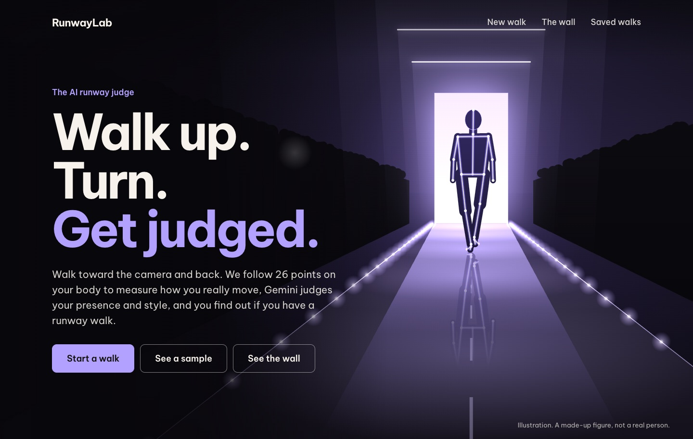

# RunwayLab

Walk toward a camera and back. Pose tracking measures how you move, on your own device. Gemini judges your presence and style. You get a score out of 100, the reasoning behind every point, and the walk closest to yours.

Built at HackTrent 2026.



## Run it

You need Node 20 or newer and Chrome.

```bash
npm install
npm run dev
```

Open <http://localhost:4700> and allow the camera. With no key it still works, and scores the measured half, out of 70.

To add the judge, copy `.env.example` to `.env.local` and add a Gemini key from [mlh.link/aistudio](https://mlh.link/aistudio). `.env.local` is ignored by git, so the key stays on your computer.

The free tier allows 20 requests per model per day, resetting at midnight Pacific time. Each judged walk is one request, and the judge moves on to the next model when one runs out or is busy. For a busy demo, turn on billing in AI Studio and set `GEMINI_PAID_TIER=1`. When no model is left, the walk keeps its measured score and says why.

### Filming

- Put the camera about waist height, with at least 6 m of clear floor in front of it.
- Keep it still. An iPhone connected through Continuity Camera works well, and the app asks for 1920 × 1440 at 60 fps.
- Stand tall until the app says you are calibrated, then walk. It counts your walks, tells you where to turn, and stops by itself.

## How the score works

70 points are measured. Up to 30 come from Gemini. Code adds up the total, so Gemini never states it.

| Part | Points | What it looks at |
|---|---:|---|
| Foot placement | 20 | How far apart your feet land, side to side |
| Posture | 18 | Shoulder rock and level, trunk sway, head height, chin, head tilt, bounce |
| Rhythm | 12 | Variation in step timing and in speed |
| Straight line | 6 | How far you stray from a straight path, wherever it points |
| Head steadiness | 6 | How far your head moves relative to your shoulders |
| Arms | 4 | How much your arms swing, and how evenly |
| Turn | 4 | How long your turn takes, and how far your hips wander |
| Presence (Gemini) | 15 | Confidence, intent and how you carry yourself |
| Style (Gemini) | 15 | How your outfit and attitude work together |

Every part shows what was measured, the scale it was held to, how much of the marks it earned and, where real footage or a study gives one, what real walkers measured. The result opens with your strongest part and your biggest win. Shown for interest and worth no points: hip movement and toe direction.

## Making it fair and accurate

**Lengths are a share of your own height.** While you stand still, the app measures your height in torso lengths. On-screen torso length then gives the scale in every frame, because every body part's on-screen size is proportional to 1 / distance. Shoulder width is not used: it differs between bodies, and it shrinks when you rotate.

**Posture is compared with you.** Head height, chin and head tilt are judged against how you stood a moment earlier, not an average person.

**Setup noise is taken off.** Standing still shows how much this camera and tracker wobble with nothing moving. That amount is taken off your walking measurements. It is also the smallest movement this setup can honestly claim to see, and the result shows it.

**Hidden means left out.** Hair or a head covering over the ears moves the head measurements to the top of the head. A gown over the feet leaves foot placement out, and the other parts are scaled up to 70, with the result saying so. Below 40 measurable points, the app refuses to score.

**Walking off-centre does not matter.** A foot closer to the camera looks further from the middle of the picture, so someone walking 30 cm off-centre would appear to have feet about 4% of their height further apart than they are. That error points the same way whichever foot is closer, while left minus right changes sign, so averaging over two footfalls cancels it. The same goes for an angled path or a camera that is not level. Straight line measures straying from the best-fit path, so a straight walk that is not aimed at the camera costs nothing.

**Several walks, not one.** Each walk is measured by itself, and the score uses the median of each measurement, so one stumble or one patch of bad tracking cannot move it far. A walk that cannot be measured is dropped and the others carry the score.

**Every frame of a 60 fps video.** A playing video is tied to the display, which on a real 1920 × 1440, 60 fps clip let the tracker see only 13 to 28 samples a second. So recordings are decoded directly with WebCodecs, which gives every frame with its exact time, even when the page is in the background. On a test walk with even steps, step timing noise fell from 1.8% at 30 samples a second to 1.0% at 60. A computer that cannot keep up falls back to 30, and a file that cannot be decoded falls back to playing it. The result says which happened, and how many samples a second it got.

### Where the numbers come from

No published study sets targets for a runway walk, so the rules are ours and this is a game. Foot placement has the most weight because it has the clearest evidence. Every source below was read in full.

| Value | Source | What it changed |
|---|---|---|
| 10 model applicants averaging 177.2 cm: step width 1.54 cm. 10 other women averaging 172.3 cm: 8.12 cm. That is 0.9% and 4.7% of height. Walking speed did not differ significantly (1.50 against 1.39 m/s). The authors link this walk to possible injury risk. | [Moon and Choi 2025](https://doi.org/10.5103/KJAB.2025.35.3.157) | Foot placement is worth the most |
| Preferred step width 0.13 leg lengths, 10 adults, leg length 0.93 m. About 6.9% of height, taking leg length as 53% of height. | [Donelan, Kram and Kuo 2001](https://doi.org/10.1098/rspb.2001.1761) | No foot marks from 7% |
| One iPad 4.2 m in front of the walker against motion capture: step width 9.6 against 10.6 cm, limits of agreement +1.3 to −3.3 cm | [Ksoll and others 2025](https://doi.org/10.3390/s25216551) | Full foot marks start at 2.5%, since smaller differences are within the error |
| Trunk obliquity range in 20 adults walking barefoot: 3.3 ± 1.4° (women 3.1°) | [Chung and others 2010](https://pmc.ncbi.nlm.nih.gov/articles/PMC2843703/) | Trunk sway counts for little |
| Vertical movement of the centre of mass in 10 adults: 2.74 cm at 0.7 m/s, 3.61 at 1.0, 4.06 at 1.2, 4.89 cm at a self-chosen 1.61 m/s | [Orendurff and others 2004](https://doi.org/10.1682/JRRD.2003.10.0150) | Only exaggerated bounce costs points |
| Stride time variation in 29 young adults: 2.2 ± 0.7% at their own speed, rising to 3 to 5% when slower | [Beauchet and others 2009](https://pmc.ncbi.nlm.nih.gov/articles/PMC2731039) | Rhythm keeps full marks up to 5% |
| 7 professional models and 10 other women on a treadmill at 1.0 m/s, pooled. Attractiveness ratings correlated with backward arm swing (r = .66 to .72), a head tilted down (r = .65 to .68) and, in heels, a steadier head (r = −.44) | [Tanabe and Yamamoto 2023](https://doi.org/10.1038/s41598-023-45130-2) | Only looking at the floor costs points. Head steadiness stays. |

The foot scale gives full marks at 2.5% of height and none at 7%. Ordinary walkers at 4.7% earn about 10 of the 20 points.

### Showreel edits

`npm run showreel` makes a 15-second, 60 fps motion-graphics edit of one walk, cut to a music drop, entirely on this
computer:

```bash
npm run showreel -- ~/Downloads/2026-11-07_0827_5ee314ce.webm
npm run showreel -- walk.webm --music song.mp3 --drop 62.5 --palette ember --socials @name
npm run showreel -- walk.webm --intro "NO JUDGES.|JUST|MATH." --turn "PIVOT" --preview
```

The style, beat by beat: three intro words slam in on the three beats before the drop over a frozen frame that turns
into a skeleton; the drop opens on the first walk with live tracking and the walker's real numbers; the turn plays in
slow motion inside a dial; a montage gives one detail per beat (shoulders, feet, a triptych, head, a mirror,
posture lines, the back) and whips into a chronophotograph of the last walk; the score builds bar by bar and slams.

Each edit is different: the next unused drop in the music library (`~/Music/RunwayLab`, the app's tracks and the
phonk mixes in Downloads), a palette not used in the last two edits (violet, ember, acid or ice), and an intro line no
recent edit used. Every caption can be set by hand. Socials come from `--socials` or the `.json` saved beside a
recording, and appear as a tag. `--preview` writes 12 stills instead of a video. Edits and their history go to
`reels/`, which git and Vercel ignore. Music from the mixes is not cleared for posting.

## Making a reel from your walks

`npm run reel` turns walk videos into a vertical 1080 × 1920 reel for Instagram, entirely on this computer:

```bash
npm run reel                                    # every clip in recordings/, with the app's house track
npm run reel -- ~/Downloads/walks --music song.mp3 --music-start 32 --out pitch.mp4
```

The real tracker finds the walk toward the camera, the turn and the walk back in each clip, and scores it. The best
walk opens with a freeze frame and its tracked skeleton, then each walk is cut on the beat: jump cuts alternating wide
and close, the turn at half speed, the walk back sped up, and a score card at the end. The tempo of the app's own
tracks is known; for other music it is detected, or pass `--bpm`. `--music-start` jumps to the drop, snapped to a
beat. `--max` sets how many walks (default 4, best first) and `--title` the opening line. Reels go to `reels/`,
which git and Vercel ignore. The scores are the measured 70 points, since Gemini's half lives in the browser.

## Checked against real footage

To test the rules on real walks, real footage went through the app's own tracker and measuring code:

- **Professional models.** The [Emporio Armani spring 2016 show](https://commons.wikimedia.org/wiki/File:Emporio_Armani_2016_Spring_Summer_Women_Collection.webm), filmed from the end of the runway by Stile Italia TV (CC BY 3.0, 1280 × 720, 25 fps). It was cut at scene changes into 50 shots. 14 showed a model's whole upper body walking at the camera, 9 of them with both feet clear.
- **Everyday walkers.** Five stock clips from [Mixkit](https://mixkit.co/license/) of people walking toward a camera (numbers 21358, 32618, 35992, 49579 and 596).

Each shot was measured as one walk toward the camera, with the minimum length lowered to 1.5 s for the short shots and no standing calibration. Middle values:

| Measurement | Professional models | Stock clips | Separates them? |
|---|---:|---:|---|
| Foot placement, % of height | 3.0 (1.7 to 4.3) | Only 2 clips usable | Compared with published 4.7 to 6.9% instead |
| Shoulder rock | 2.6° | 5.6° | Yes |
| Head movement, % of height | 1.7 | 3.3 | Yes |
| Trunk sway | 2.2° | 2.1° | No |
| Bounce, % of height | 2.5 | 1.3 | No, and the models bounced more |
| Arm swing, % of height | 2.2 (1.4 to 4.8) | 1.7 | No |
| Step timing variation | 5% | Too few steps | Not tested |

What changed as a result: the models were losing marks for bounce, trunk sway and a small arm swing, none of which separated them from anyone. Those now count for little or allow more, and the points sit with feet, shoulders and head steadiness. Scored by the app's own code on the parts these shots can show (feet, rhythm, posture, head and arms), the models' middle score went from 72% to 83% of the points. The two stock clips with feet visible went from 28% and 64% to 26% and 66%. The synthetic test walks score 70, 41 to 43, and 17 to 18 of 70 for catwalk, casual and sloppy.

These are small samples from video that was not filmed for this, so treat them as a check on the rules, not a study. The broadcast camera zooms and pans: lengths are ratios within each frame, so zoom does not change them, but it can distort pace, shoulder level, straight line and bounce, so the models' real scores on those are probably higher than measured here. Stock clips may use actors and are often in slow motion, so their timing was not used. The footage is not part of this repository.

The thresholds have not yet been tuned on a set of real walks filmed for this app. To see every number behind a score for your own clips, keep them on your computer and run:

```bash
node scripts/analyze-clip.mjs walk1.mov walk2.mov
```

### What it cannot do

- From the front, it cannot see forward lean, or how far your arms swing behind you.
- Trackers can be less accurate on some bodies and in some clothes. Taking measurements relative to each person reduces the effect, but does not remove it. [LaChance 2023](https://r2hcai.github.io/AAAI-23/files/CameraReadys/21.pdf) looks at this for other pose models, and no audit of RTMPose was found.
- Gemini's half is an opinion. It sees stills with faces pixelated and is told to ignore body, face, age, race and gender, but instructions do not guarantee that.
- The camera must not move.

## Tracking

The app uses RTMPose-m with 26 body points, including the top of the head, the neck, and three points on each foot, run through ONNX Runtime Web on WebGPU. RTMDet-nano finds the person. If WebGPU or the model fails, it falls back to MediaPipe. Recordings are analyzed after the walk, forward and backward, so the skeleton does not lag behind the body.

Comparison on the same real clips, at 15 samples a second, on an M4 Pro in Chrome. "Ankles" is how often the tracker placed an ankle inside the picture, which is not the same as placing it correctly. The close clip is cropped so that the feet are out of frame.

| Clip | Tracker | Points | Median ms | Torso found | Ankles | Knees | Jitter |
|---|---|---:|---:|---:|---:|---:|---:|
| Full body | RTMPose-m | 26 | 18.4 | 1.00 | 0.89 | 1.00 | 0.033 |
| Full body | RTMW-l | 133 | 28.4 | 1.00 | 0.96 | 1.00 | 0.035 |
| Full body | MediaPipe full | 33 | 9.2 | 1.00 | 0.66 | 1.00 | 0.024 |
| Close crop | RTMPose-m | 26 | 18.0 | 0.95 | 0.00 | 0.26 | 0.034 |
| Close crop | RTMW-l | 133 | 27.9 | 0.96 | 0.00 | 0.48 | 0.036 |
| Close crop | MediaPipe full | 33 | 8.8 | 0.66 | 0.00 | 0.00 | 0.024 |

**More points did not help.** RTMW-l adds hands and a face, which are too small to place well in a full-body view, and its overlays looked the same as RTMPose-m's. It is about 55% slower, and at 129 MB it is over GitHub's file limit. To run the comparison yourself, download it and set `RTMW_MODEL` and `TRACKERS=rtmw,rtmpose-m` for `node scripts/bench-trackers.mjs`.

### Public projects looked at

| Project | Licence | Notes |
|---|---|---|
| [MMPose](https://github.com/open-mmlab/mmpose) with RTMPose | Apache-2.0 | Used. Model weights were trained on datasets with their own terms. |
| [ONNX Runtime](https://github.com/microsoft/onnxruntime) | MIT | Used, to run RTMPose in the browser |
| [MediaPipe](https://github.com/google-ai-edge/mediapipe) | Apache-2.0 | Used as the fallback |
| [rtmlib](https://github.com/Tau-J/rtmlib) | Apache-2.0 | Python wrapper, useful as a reference |
| [ViTPose](https://github.com/ViTAE-Transformer/ViTPose) | Apache-2.0 | Accurate but heavy for a browser |
| [Sports2D](https://github.com/davidpagnon/Sports2D) | BSD-3-Clause | 2D angles, needs filming side-on |
| [Pose2Sim](https://github.com/perfanalytics/pose2sim) | BSD-3-Clause | Needs several cameras |
| [opencap-processing](https://github.com/opencap-org/opencap-processing) | Apache-2.0 | Gait measures, including step width, from its own capture system |
| [Ultralytics YOLO](https://github.com/ultralytics/ultralytics) | AGPL-3.0 | Not used, because of the licence |
| [Sapiens](https://github.com/facebookresearch/sapiens) | Custom | Not used, because of its size and licence |

## How it fits together

```
camera or upload → recording → tracker → frames.mjs → phases.mjs → metrics.mjs → score.mjs → total
                                                                                     ↑
                                         pixelated stills, with consent → api/judge.mjs (Gemini)
```

- `src/lib`: all the measuring and scoring, with no browser code, so it is tested in Node and runs the same on the server.
- `src/pose`: the trackers, and reading frames out of a recording with WebCodecs and mp4box.js.
- `src/capture`, `src/judge`, `src/store`, `src/wall`: the camera, stills for the judge, saved walks, and the wall.
- `src/ui`: the screens. `scene.mjs` draws the home page's picture from the same pinhole camera model the measurements assume.
- `api`: small server functions for Vercel. `scripts/dev.mjs` runs the same files locally.
- `vendor`: everything the page loads, including models and fonts, so nothing comes from another site.

The wall recomputes the measured half on the server from the posted skeleton, and only accepts judge results signed by this server, so a score on the wall cannot be typed in.

## Privacy

Your video stays in the browser. Every recording is kept automatically in this browser's saved walks, and the Saved walks page can download them all. Under `npm run dev` each video is also written to `recordings/` in the project folder, which git and Vercel both ignore. It is never uploaded anywhere else. Only two things can leave the device, each only if you choose: pixelated stills for Gemini, and your name, score and skeleton movement if you post to the wall. A content security policy limits the page to connecting to its own site, which also stops MediaPipe's own metrics calls.

Gemini's free tier may use what it receives to improve Google's products. The consent text says so, unless `GEMINI_PAID_TIER=1` is set.

## Tests

```bash
npm test
npm run e2e
```

`npm test` runs the logic, judge and wall tests in Node. Synthetic walks with known geometry check that measurements match the truth and do not depend on where someone walks, how they are built, or what they wear. Those walks are our own assumptions about walking, so passing proves the logic, not that the rules suit real people.

`npm run e2e` drives real Chrome through the whole app with a fake camera. It needs ffmpeg.

## Deploying

Everything works on Vercel with no build step. Set `GEMINI_API_KEY`, `WALL_SECRET`, `DATABASE_URL` and, for sign-in, the three `AUTH0_` values, then run `node scripts/wall-db.mjs setup` once. Without a database, the wall uses a local file for testing and says so.

## Licences

See [NOTICE.md](NOTICE.md) for the models, fonts and music.
